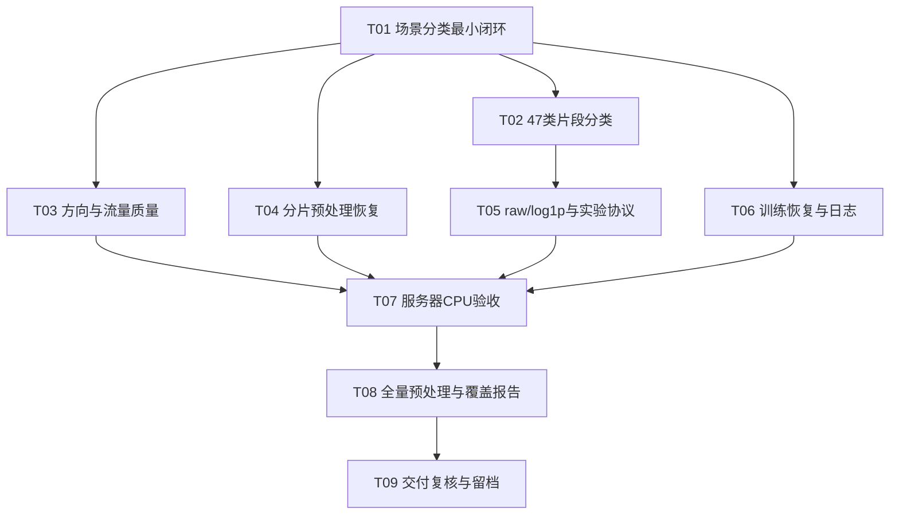

# AgentPrint ANT：ticket拆分与依赖DAG

依据：[规格](../../design/2026-10-29-agentprint-issue-spec.md)、[详细设计](../../design/2026-10-29-agentprint-development-spec.md)、领域术语与现有四项ADR。测试主边界已经用户确认：公开prepare→train→evaluate及产物，补充公开模型输入/输出、CE和反向传播。

状态：用户已于2026-10-29明确授权按此DAG派发subagent完成所有任务，主agent集成测试并使用Git；实现已启动，进度见[执行记录](execution.md)。9份独立issue正文尚未发布至tracker，tracker配置与发布保持待办；按用户直接启动指令，此待办不阻塞开发。文档区的票据不冒称已配置的本地tracker，正式发布后再映射为真实issue ID并应用`ready-for-agent`标签。

## 拆分

1. **[T01 跑通场景分类的最小完整闭环](drafts/01-scenario-tracer.md)**。Blocked by：无。交付：从可手算PCAP经公开命令生成场景MTAM、真实RF训练和验证结果，并建立后续扩展共用的最终输入/清单/缓存契约。
2. **[T02 跑通标注片段的47类独立分类](drafts/02-primitive-tracer.md)**。Blocked by：T01。交付：标注起点→合法片段→47类独立训练评估，包含重复起点和场景资格独立性测试。
3. **[T03 按完整方向与流量质量规则生成样本](drafts/03-traffic-quality.md)**。Blocked by：T01。交付：多协议/IPv6/背景或损坏捕获按规则形成可消费缓存或可解释排除记录。
4. **[T04 中断后恢复兼容的分片预处理](drafts/04-resumable-preparation.md)**。Blocked by：T01。交付：中断→兼容检查→只重做未完成分片→继续训练评估，核对恢复结果。
5. **[T05 完成raw/log1p比较与正式实验协议](drafts/05-experiment-protocol.md)**。Blocked by：T02。交付：两个任务四配置、验证选优、指标/缺类/同分规则和正式参数门控，通过小构造数据验证。
6. **[T06 恢复训练并保留一致的日志与结果](drafts/06-training-recovery.md)**。Blocked by：T01。交付：独立运行→中断→恢复→一致指标/文件/TensorBoard，保留best和last。
7. **[T07 在服务器完成四配置CPU真实数据验收](drafts/07-server-cpu-acceptance.md)**。Blocked by：T03、T04、T05、T06。交付：同一集成提交在当前无卡服务器上的四配置真实小样本验收与证据。
8. **[T08 生成全量缓存与有效数据覆盖报告](drafts/08-full-preparation.md)**。Blocked by：T07。交付：全量两任务官方split缓存、有效/排除清单、支持数/覆盖率及正式训练资格报告。
9. **[T09 复核首次交付并留档复现证据](drafts/09-delivery-evidence.md)**。Blocked by：T08。交付：以实际运行产物核对命令说明，提交轻量证据并如实标明后续GPU实验未执行。

T01是一个范围刻意收窄的可运行闭环，仍使用真实RF/CE，不是先把解析层、模型层、训练层分别堆完。T02–T06各自扩展一项能从公开入口演示的行为；T07–T09是已确认的部署验收、数据执行和交付工作。独立新增模块无需为了本次目标先改造整套旧baseline，当前没有必须另开票的宽范围前置重构。

## DAG

箭头从阻塞票指向被阻塞票；只列直接依赖，省略传递边。唯一机器可读依赖源为[dag.json](dag.json)，图源为[dependencies.mmd](dependencies.mmd)。

## 每条依赖的原因

| 直接依赖 | 真正阻塞的内容 |
|---|---|
| T01→T02 | 给定片段需要复用已跑通的包/MTAM/缓存/训练评估公共契约 |
| T01→T03 | 完整流量边界扩展依赖一个可以实际消费有效样本的闭环 |
| T01→T04 | 缓存恢复必须基于已经存在且可训练消费的最终分片/清单契约 |
| T01→T06 | 训练恢复和日志必须建立在真实RF训练和checkpoint闭环上 |
| T02→T05 | 四配置协议需要两个真实独立任务，而不只是五类任务或伪造47类结果 |
| T03→T07 | 服务器真实样本必须按完整方向/质量口径处理 |
| T04→T07 | 服务器验收使用最终可恢复缓存，不验收之后还要替换的中间格式 |
| T05→T07 | 四配置真实验收依赖已固定输入变换、指标和正式/smoke隔离 |
| T06→T07 | 验收必须核对最终checkpoint、结果和日志状态，而不只是训练进程退出成功 |
| T07→T08 | 用户已明确CPU小样本通过后再处理全量数据 |
| T08→T09 | 最终留档与交付复核需要实际全量覆盖和排除结果 |

T07不重复声明T01/T02，因为已被传递依赖覆盖。T03与T04不因最终要支持Primitive就额外依赖T02：它们可以用场景闭环验证通用包/缓存行为，Primitive接入在T07集成验证。T06也不为了复用训练状态而等待T05；四配置集成在T07核对。这里的并行要求T01先建立契约，实施时若发现新增真实阻塞，须记录理由、更新DAG并磋商，不能以伪数据掩盖缺失前提。

## 后续多agent执行规则（供本次审阅）

- **执行授权**：用户已明确要求派发subagent完成所有任务，主agent集成测试。按此授权执行，不在ticket之间重复请求开始；tracker配置/发布仍是独立待办。
- **按frontier派发**：阻塞票全部通过验收且已集成、当前票尚无执行者时才可领取。初始只有T01；T01完成后T02/T03/T04/T06可并行；T02完成即可派T05，不必等T03/T04/T06都结束。最后T07→T08→T09串行。
- **不把图层当屏障**：按当时可用agent槽位调度，某一票完成即可释放其后继；不预先承诺固定并发数，不以最大化并发为由编造独立依赖。
- **划清修改范围**：T02负责片段/标注行为，T03负责流量/方向质量，T04负责缓存恢复，T06负责训练状态/日志，T05负责四配置/指标选择。共享命令路由、配置契约和相同测试段由协调agent安排合入，不让多个代理覆盖同一修改。
- **开发隔离与集成**：独立任务使用隔离分支/checkout；实施前核对适用仓库规则，避免多个agent同时改同一工作区。协调agent顺序合入，检查重叠改动并运行相关回归。代理自报完成不等于集成完成，后继票使用已集成版本。
- **资源互斥单独管理**：环境安装、共享服务器checkout变更、真实CPU训练和全量预处理由协调agent串行调度。代码并行不表示在小内存无卡服务器同时跑多个重负载；资源占用不伪装成业务依赖边。正式GPU四配置后续执行时仍按规格串行。
- **测试随ticket交付**：每票包含本行为的公开入口测试和可复现实证；T07做汇合集成与真实数据验收，不把前六票的测试全部推迟到T07。
- **状态可追溯**：执行时将草稿ID映射为真实tracker ID，维护待做/执行中/验收/已完成状态、owner、提交和证据。dag.json目前是静态计划，不是已实现的自动调度器；后续代理依其blocked_by选择工作，不凭空引入外部调度服务。
- **范围不变**：本次终点是CPU验收和全量预处理/留档；GPU正式训练不加入这9票，避免把尚未授权执行的后续阶段伪装成当前阻塞工作。不关闭或改动任何父issue。

## 发布状态

拆分与启动已由用户的后续执行指令确认。tracker缺失时，正式发布前仍需`/setup-matt-pocock-skills`，不擅自选本地tracker或假称已创建issue；这不撤销用户已经给出的开发授权。
