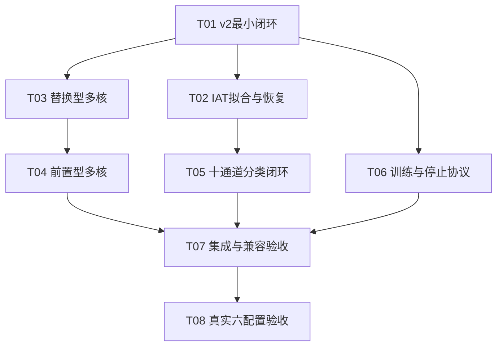

# AgentPrint IAT多视角与多核：ticket草稿与依赖DAG

依据：[Issue规格](../../design/2026-11-01-agentprint-iat-multikernel-issue-spec.md)（提交6c89e44）、[完整设计](../../design/2026-11-01-agentprint-iat-multikernel-spec.md)、已确认测试边界、领域术语及ADR 0005。

状态：8张独立ticket正文草稿，等待用户确认拆分粒度和依赖；未发布tracker、未应用标签、未派发agent、未开始实现。项目仍缺少tracker及triage映射，正式发布前按技能运行/setup-matt-pocock-skills。本文档目录不是擅自配置的本地tracker；发布后映射实际issue ID，并应用ready-for-agent标签，不修改或关闭父Issue。

## 拆分与独立交付

1. **[T01 跑通兼容旧协议的v2最小闭环](drafts/01-v2-tracer.md)**。Blocked by：无。交付：v2配置以合成MTAM跑通单核训练/评估及模型重建，建立扩展合同，v1保持原协议。
2. **[T02 通过公共命令拟合并恢复共享IAT桶](drafts/02-fit-bins.md)**。Blocked by：T01。交付：显式fit-bins输出train-only、Episode等权的可恢复桶产物，可独立核验边界和身份。
3. **[T03 运行替换首单元的多核模型](drafts/03-replacement-model.md)**。Blocked by：T01。交付：替换型经合成MTAM公共训练/评估可用，提供已验证的共享多核单元；10通道公开接口可用合成张量核验。
4. **[T04 运行无残差的前置多核模型](drafts/04-prepend-model.md)**。Blocked by：T03。交付：复用共享多核，实现前置型合成闭环与正确checkpoint重建。
5. **[T05 跑通可恢复的十通道IAT分类闭环](drafts/05-iat-tracer.md)**。Blocked by：T02。交付：已拟合产物→IAT补充缓存→sample_id关联→十通道单核训练/评估，含分片恢复。
6. **[T06 执行可恢复的v2训练与严格停止协议](drafts/06-training-protocol.md)**。Blocked by：T01。交付：新学习率、正式停止接口、验证选模与完整epoch恢复；通过合成历史和公共smoke核验，不跑真实正式训练。
7. **[T07 集成十二配置并核验旧产物与恢复](drafts/07-integrated-acceptance.md)**。Blocked by：T04、T05、T06。交付：三条工作线汇合，完成十二配置接口、六种IAT合成全流程、组合恢复及真正旧产物回归。
8. **[T08 完成六配置真实小样本验收并交付证据](drafts/08-bounded-server-acceptance.md)**。Blocked by：T07。交付：确定性选样及验收入口、数据盘六组2轮运行、最佳checkpoint验证与恢复证据。

每票包含公共行为、验收标准和阻塞票，不把数据层、模型层、测试层拆成各自不能演示的横向任务。T01是必要的有限前置改造，仍以可运行闭环验收；后续票各自带测试，不把测试整体推迟到T07。

## DAG

唯一机器可读依赖源为[dag.json](dag.json)，独立Mermaid源为[dependencies.mmd](dependencies.mmd)。箭头表示“先完成并集成阻塞票，才能开始后继票”，只保留直接边。

## 每条依赖的原因

| 阻塞边 | 原因 |
|---|---|
| T01→T02 | 拟合需要v2配置、公共命令分流和扩展身份合同。 |
| T01→T03 | 变体需可配置模型构造、保存定义重建及合成训练闭环。 |
| T01→T06 | 训练协议依赖v2可运行状态与身份，不应改写v1规则。 |
| T03→T04 | 前置型复用T03已验证的共享多核单元，避免两agent各建不一致实现。 |
| T02→T05 | 补充缓存必须消费真实拟合产物及共同IAT语义，不能自造替代边界。 |
| T04→T07 | 三变体矩阵需要前置型完成；其依赖已传递包含替换型。 |
| T05→T07 | IAT开启的完整矩阵依赖真实补充缓存关联路径。 |
| T06→T07 | 组合恢复与正式停止合同需要v2训练协议先可用。 |
| T07→T08 | 真实运行只应使用已集成验证、可记录版本的实现。 |

T03/T04不被T02/T05阻塞：它们先用已有基础MTAM合成样本及2/10通道公开模型接口独立验收。T05不被多核票阻塞：先跑单核十通道闭环。T06不被IAT或多核阻塞：先在v2单核合成闭环验证协议。全部组合在T07核验，因此依赖既不形成环，也不靠未实现代码假运行。

## 多agent执行建议（待批准，不代表已派发）

1. 先执行T01并集成，冻结公共合同及真正旧协议回归基线。
2. 可同时派3个实现agent：A做T02，B做T03，C做T06；主agent负责合同答疑、逐票审查和集成。
3. A的T02通过并集成后即可做T05；B的T03通过并集成后即可做T04。不必等待另一条线或C完成，按实时frontier调度。
4. T04、T05、T06全部集成并各自验证后，主agent执行T07集成验收。
5. T07通过后执行T08；六组真实训练保持串行，开发并行不改变真实执行预算。主agent复核交付证据。

调度前提是阻塞票状态为“已集成且已验证”，不是agent口头完成或仅有未合并分支。DAG不代表任何票可以越过代码审查直接消费另一个agent的工作目录。

各实现agent使用codex/前缀独立Git分支及隔离工作区，以已集成依赖为基线。并发票难免触及公共配置、CLI注册、模型选择和训练身份等共享接点；T01先定合同，主agent串行集成这些改动。共享文件冲突属于合并协调，不人为增加功能依赖；发现需修改合同应先回报，不允许各线各改一套协议。

## 规格覆盖与执行边界

dag.json各节点的decisions对应Issue规格Implementation Decisions编号，用于追溯，覆盖全部28项；不是新决策或额外依赖。

| 合同组 | 主要负责票 | 最终验证 |
|---|---|---|
| v2入口、模型重建、v1不变 | T01 | T07 |
| IAT定义、抽样、等权边界、拟合恢复 | T02 | T05、T07 |
| 替换型和共享多核 | T03 | T07 |
| 前置型 | T04 | T07 |
| 独立缓存、关联、10通道、分片恢复 | T05 | T07 |
| 新锚点、停止、选模、完整epoch恢复 | T06 | T07 |
| 全矩阵与真正旧产物、test合成路径 | T07 | T08交付复核 |
| 真实选样、数据盘、六组2轮与证据 | T08 | 主agent交付复核 |

本轮真实样本每类最多4train/2val，合计最多20/10，仅所选train拟合。真实test不读取；IAT关闭组不重做真实训练；六组IAT开启配置各seed42、2轮、batch200，统一锚点。全量预处理、正式训练、调参、TCN和47类新功能均不在票据执行预算内。

测试主边界仍为公共fit-bins→prepare→train→evaluate及产物/身份/恢复结果，公开模型形状、CE、反向与旧模型一致性为必要补充。停止规则沿用已批准合成历史测试先例，不为验证规则启动真实200轮训练。

## 待用户确认

- 8张票的粒度是否合适，是否需要合并或进一步拆分？
- 直接依赖是否正确，尤其T03→T04复用多核，以及T02→T05先跑通单核IAT？
- 若整体认可，可回复“按这个拆分”；确认后再处理tracker发布及后续执行，不在本轮提前派发或修改任何父Issue。
